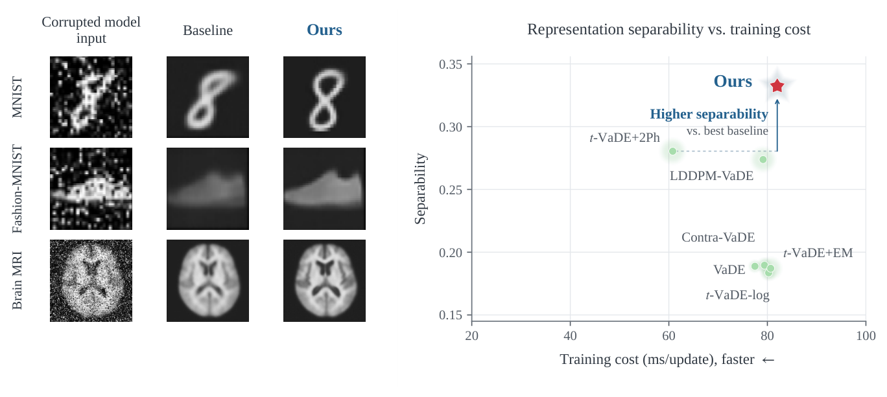
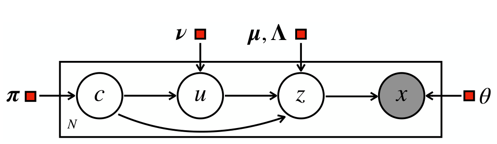

# Pro-t-VaDE: Robust Prototype Discovery via Closed-Form Student-t Variational Deep Embedding

**Zhikang Xu, Jiarui Xing, Jian Wang** · NeurIPS 2026

Paper: arXiv link coming soon · [Library usage](docs/usage.md) · [Reproducing experiments](experiments/README.md) · [Citation](#citation)

Pro-t-VaDE is a robust deep generative framework for unsupervised image
prototype discovery. It places a heavy-tailed Student's t mixture prior on the
latent space of a variational deep embedding model. This combines robustness to
corrupted inputs with an exact, closed-form training objective, at a modest
computational cost.



*Left: noise-corrupted inputs, diffusion-based baseline prototypes, and
Pro-t-VaDE prototypes on MNIST, Fashion-MNIST and brain MRI. Right: mean
cluster separability against training time per update, on brain scans.*

## Method



Gaussian mixture priors penalize distant latent codes quadratically, so a few
outliers can draw prototypes toward spurious modes. Diffusion-based priors are
more expressive, but iterative sampling and intractable likelihoods limit their
scalability and interpretability for prototype discovery. Pro-t-VaDE instead
gives each cluster *c* a **Student's t** prior, expressed as a scale mixture of
Gaussians. An auxiliary precision *u* ~ Gamma(ν_c/2, ν_c/2) scales the
covariance of *z*. Small values of *u* accommodate tail observations, while
large values concentrate the component around its prototype μ_c. This
formulation has three key properties:

- **Closed-form augmented ELBO.** Gaussian–Gamma conjugacy lets *u* be
  integrated analytically. This gives exact gradients without sampling or
  biased variational approximations.
- **Adaptive outlier downweighting.** The inferred precision acts as a
  data-dependent measure of trust, which reduces the influence of corrupted
  samples on the prototypes.
- **Per-cluster tail adaptation.** The degrees of freedom ν_c are learned
  jointly with the model. Each cluster adapts its tail behavior to the data,
  so no global robustness hyperparameter is needed.

## Key results

**Clustering under Cauchy noise**, averaged over γ ∈ {0.02, …, 0.14} (K = 10):

| | MNIST ACC | ARI | NMI | Fashion-MNIST ACC | ARI | NMI |
|---|---:|---:|---:|---:|---:|---:|
| Best baseline (per metric) | 0.727 | 0.575 | 0.656 | 0.390 | 0.214 | 0.373 |
| **Pro-t-VaDE** | **0.798** | **0.695** | **0.753** | **0.555** | **0.409** | **0.570** |

Pro-t-VaDE leads on every metric on both datasets. On Fashion-MNIST it achieves
a ~42% relative ACC gain over the strongest baseline, and the gains are
statistically significant across random seeds.

**Brain MRI prototype discovery** (OASIS, K = 2, mean of the sagittal, axial
and coronal views, γ = 0.12):

| | Silhouette ↑ | Davies–Bouldin ↓ | PSNR (dB) ↑ | Collapsed runs ↓ |
|---|---:|---:|---:|---:|
| Best baseline | 0.309† | 1.300† | 19.82 | 1 / 118 |
| **Pro-t-VaDE** | **0.351** | **1.099** | **20.01** | **0 / 118** |

Pro-t-VaDE achieves the best separability and reconstruction without a single
collapsed run, and the highest Silhouette under all nine realistic MRI
corruptions tested. (†Averaged over non-collapsed runs only.)

## Installation

Requires Python 3.10+ and PyTorch 2.1+.

```bash
python -m pip install "git+https://github.com/xuzhikangnba/torch-tvae.git"
```

The core package depends only on PyTorch. The multi-cluster models used in the
paper are available as reference classes:

```python
from tvae.reference import TVaDE28, TVaDE128

digits = TVaDE28(latent_dim=8, num_clusters=10, nu_init=5.0)  # 28x28 images
brain = TVaDE128(latent_dim=32, num_clusters=2, nu_init=5.0)  # 128x128 MRI
```

The Student-t prior can also replace the Gaussian KL in an existing VAE:

```python
from tvae import StudentTPrior

prior = StudentTPrior(latent_dim=16, df=5.0, learn_df=True)
loss = (reconstruction_nll + prior.kl_bound(mean, logvar)).mean()
```

See [docs/usage.md](docs/usage.md) for the single-component `TVAE`, custom
encoders and decoders, and saving and loading models.

## Reproducing the paper

From a source checkout:

```bash
python -m pip install ".[experiments]"
python experiments/run_reference.py --dataset mnist --data-root ./data \
  --output ./outputs/mnist-g012 --gamma 0.12 --epochs 100 --device cuda:0
python experiments/summarize_reference.py --run ./outputs/mnist-g012 \
  --output ./outputs/mnist-comparison.json
```

MNIST and Fashion-MNIST download automatically. The OASIS MRI data needs
separate access. See [experiments/README.md](experiments/README.md) for all
datasets and noise levels.

Fresh 100-epoch reruns with this code at γ = 0.12 come close to the paper on
MNIST (ACC 0.817 vs 0.832) and on MRI (Silhouette 0.314 vs 0.351). On
Fashion-MNIST they score higher than the paper (ACC 0.599 vs 0.525). The
launcher uses the training setup stated in the paper: AdamW, learning rate
1e-3, weight decay 1e-4, batch size 32, 100 epochs. Details the paper leaves
out, such as the data split, the GMM initialization at epoch 20 and the
checkpoint-selection rule, are documented in the
[recovered configuration](docs/recovered_configuration.md). See also
[fresh results](docs/fresh_results.md) and the
[reproduction audit](docs/reproduction.md).

## Citation

```bibtex
@inproceedings{xu2026protvade,
  title     = {Pro-t-VaDE: Robust Prototype Discovery via Closed-Form Student-t Variational Deep Embedding},
  author    = {Xu, Zhikang and Xing, Jiarui and Wang, Jian},
  booktitle = {Advances in Neural Information Processing Systems},
  year      = {2026}
}
```

Code is released under the [MIT License](LICENSE). Datasets and pretrained
weights are not included.
